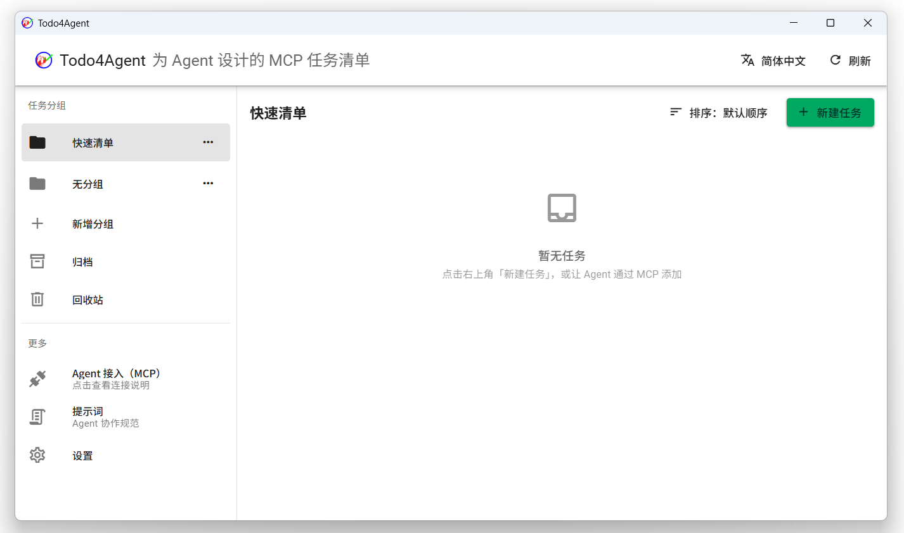

# Todo4Agent

简体中文 | [English](README.en.md)

## 软件介绍

> [!TIP]
> 更多软件信息，参见官网：<https://todo4agent.github.io/>

为 Agent 设计的 MCP 任务清单：Agent 可以通过 MCP 直接管理你的任务，你也能在界面里手动维护。

界面支持简体中文和英语两种语言；桌面应用支持 Windows、macOS 与 Linux，同时提供浏览器 WebUI。

## 下载

前往 [Releases](https://github.com/Todo4Agent/Todo4Agent/releases/latest) 下载对应平台的安装包即可。

## 软件截图

## 许可证

软件使用 [GNU AGPL v3.0](LICENSE) 协议。
